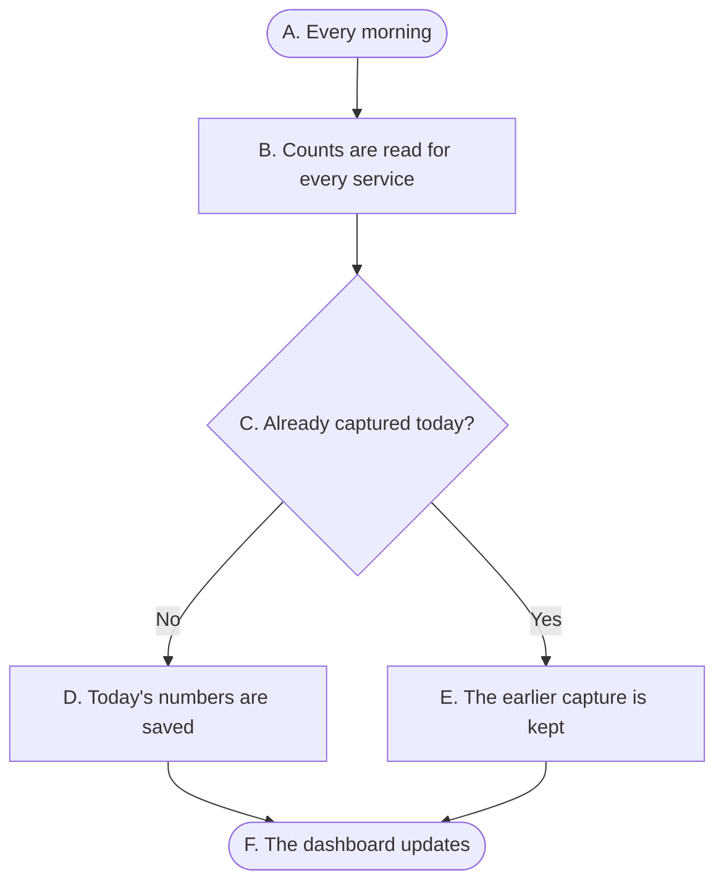

# Example Report: overview

> **End-user guide (example).** Written for people who use the product, not for people who
> build it: no repo paths or internal jargon. Pages in `confluence/` are authored here and
> published to the team wiki. Start from
> [../templates/end-user-guide-template.md](../templates/end-user-guide-template.md).

## What it is

Example Report shows how many open items each service has, by severity, for every day since
it started collecting. It answers one question quickly: **are we getting better?**

**Dashboard:** `https://<github-org>.github.io/<repo>/` _(maintainers: replace with the
published address after the first deploy)_

## Guides

| Guide | Audience | What it covers |
|---|---|---|
| [Reading the dashboard](reading-the-dashboard.md) | Service owners, leadership | The chart, the filter, and what the numbers mean. |

## How the numbers get there

| Step | At this node | Type | What happens | Then… | leading to |
|---|---|---|---|---|---|
| 1 | A. Every morning | Start | An automatic job runs once a day. | next | B. Counts are read for every service |
| 2 | B. Counts are read for every service | Process | It reads the High, Medium, and Low counts for each service. | next | C. Already captured today? |
| 3 | C. Already captured today? | Decision | Nothing has been saved for today yet. | if **No** | D. Today's numbers are saved |
| 4 | D. Today's numbers are saved | Process | Today's counts are stored and never changed afterwards. | next | F. The dashboard updates |
| 5 | C. Already captured today? | Decision | Today was already captured (for example, the job was re-run). | but if **Yes** | E. The earlier capture is kept |
| 6 | E. The earlier capture is kept | Process | The first capture of the day stays as it was. | next | F. The dashboard updates |
| 7 | F. The dashboard updates | End | The chart shows the new day. | — | — |

## Days and times

A "day" follows the Eastern calendar. Something captured at 9:30 p.m. Eastern counts for that
day, not the next.

## Getting help

Ask in the team channel, or open a bug with the platform team. Include the service name, the
date you're looking at, and what you expected to see.
