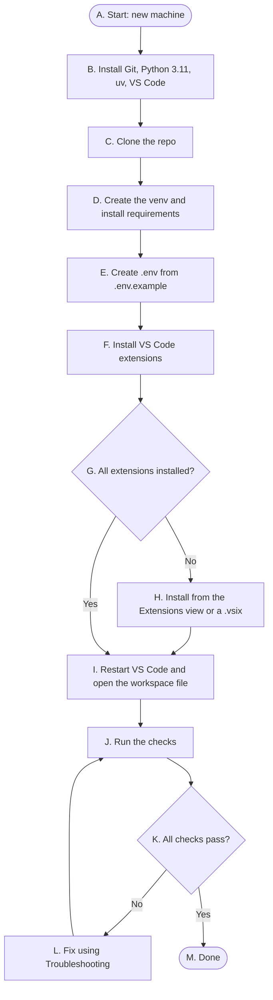

# Developer setup: new machine and VS Code workspace

Last Updated: 2026-10-12

How to set up a Windows machine so this repo works in VS Code: the agent instructions
([AGENTS.md](../AGENTS.md)), the Jira toolkit and MCP server, and the Python scripts and tests. **No admin rights are needed**;
every install below is per-user. Paths use `C:\src\<repo>` as an example; use any folder.

## Overview



| Step | At this node | Type | What happens | Then… | leading to |
|---|---|---|---|---|---|
| 1 | A. Start: new machine | Start | You have a fresh Windows machine. | next | B. Install Git, Python 3.11, uv, VS Code |
| 2 | B. Install Git, Python 3.11, uv, VS Code | Process | Install the tools per-user with `winget` ([Tools](#1-tools)). | next | C. Clone the repo |
| 3 | C. Clone the repo | Process | Clone into a parent folder you'll reuse for sibling repos ([Clone layout](#2-clone-layout)). | next | D. Create the venv and install requirements |
| 4 | D. Create the venv and install requirements | Process | One Python 3.11 venv at the repo root ([Python environment](#4-python-environment)). | next | E. Create .env from .env.example |
| 5 | E. Create .env from .env.example | Process | Add your Jira and API settings ([Secrets](#5-secrets-env)). | next | F. Install VS Code extensions |
| 6 | F. Install VS Code extensions | Process | Install the recommended extensions ([Extensions](#6-extensions)). | next | G. All extensions installed? |
| 7 | G. All extensions installed? | Decision | An install failed, usually with a certificate error. | if **No** | H. Install from the Extensions view or a .vsix |
| 8 | H. Install from the Extensions view or a .vsix | Process | Retry inside VS Code, or download the `.vsix` and use **Install from VSIX…**. | next | I. Restart VS Code and open the workspace file |
| 9 | G. All extensions installed? | Decision | Every extension is installed. | but if **Yes** | I. Restart VS Code and open the workspace file |
| 10 | I. Restart VS Code and open the workspace file | Process | Fully quit VS Code so it picks up the new PATH, then open the workspace file ([Workspace file](#3-workspace-file)). | next | J. Run the checks |
| 11 | J. Run the checks | Process | Run the tests and the Jira check ([Checks](#10-checks)). | next | K. All checks pass? |
| 12 | K. All checks pass? | Decision | Something failed. | if **No** | L. Fix using Troubleshooting |
| 13 | L. Fix using Troubleshooting | Process | Match the symptom in [Troubleshooting](#11-troubleshooting), fix it, and run the checks again. | next | J. Run the checks |
| 14 | K. All checks pass? | Decision | Everything passes. | but if **Yes** | M. Done |
| 15 | M. Done | End | The workspace is ready. | — | — |

## 1. Tools

Run these in PowerShell. None of them need admin.

```powershell
winget install --id Git.Git -e --scope user
winget install --id Python.Python.3.11 -e --scope user   # CI runs 3.11, so match it locally
winget install --id astral-sh.uv -e                       # provides uvx, which the Jira MCP server needs
winget install --id Microsoft.VisualStudioCode -e --scope user
```

Keep 3.11 even if a newer Python is installed. The venv is created with `py -3.11`, so other
versions don't get in the way.

## 2. Clone layout

Clone into a parent folder that can hold sibling repos later:

```
C:\src\
  dtc-codescan-template\
  another-repo\              <- optional sibling, added to the workspace file
```

## 3. Workspace file

The repo ships [dtc-codescan-template.code-workspace](../dtc-codescan-template.code-workspace).
**Always open it** with **File > Open Workspace from File…** or **File > Open Recent**. It sets
the interpreter, prompt-file locations, live Python logs, and search/watch exclusions for
generated folders.

- If the Explorer header reads **UNTITLED (WORKSPACE)**, you're in a scratch workspace: the
  settings don't apply, and Copilot chat history is saved separately (see
  [Copilot chat history](#9-copilot-chat-history)).
- The workspace file auto-approves one terminal command shape so routine test runs don't ask
  for approval: the venv's `python.exe -m pytest <project>\tests`, optionally with `-q`,
  `-p no:cacheprovider`, and a redirect to a `.log` file. Anything else (other scripts,
  chained commands, `pip install`) still asks. Keep auto-approve rules this narrow; a blanket
  rule for `py` or `python.exe` would let any script run unasked.
- To work across repos, add sibling folders to `folders` in the workspace file. In a
  multi-root workspace VS Code ignores window-level settings (such as
  `chat.promptFilesLocations`) in a folder's own `.vscode/settings.json`; they only work in the
  workspace file. When folders are added, `${workspaceFolder}` becomes ambiguous; use
  `${workspaceFolder:<folder-name>}` in the workspace file and in `.vscode/mcp.json`.
- Machine-specific settings (absolute paths, terminal auto-approve rules) belong in a personal
  workspace file outside the repo, not in the shared one.

**Excluded folders.** Generated data (`data/`, `.scratch/`, `.venv/`) is excluded from the file
watcher, search, and Pylance but still visible in Explorer. Searching large generated trees can
time out and look like the chat froze; open the file directly or search one subfolder.

## 4. Python environment

One venv at the repo root (`.venv`, gitignored):

```powershell
$repo = 'C:\src\dtc-codescan-template'
py -3.11 -m venv "$repo\.venv"
$py = "$repo\.venv\Scripts\python.exe"
& $py -m pip install --upgrade pip
& $py -m pip install `
  -r "$repo\requirements-dev.txt" `
  -r "$repo\jira-toolkit\scripts\requirements.txt" `
  -r "$repo\example-report\scripts\requirements.txt"
```

Add each new project's `scripts\requirements.txt` to this command and to this guide.

- **Several terminals at once is fine.** Don't `pip install` while scripts are running
  (Windows locks files in use), and don't run two jobs that write the same output.

## 5. Secrets (`.env`)

Copy [`.env.example`](../.env.example) to `.env` at the repo root and fill it in. `.env` is
gitignored.

| Variable | Value | Used by |
|---|---|---|
| `JIRA_URL` | your Jira Cloud site, e.g. `https://example.atlassian.net` | jira-toolkit, Jira MCP server |
| `JIRA_USERNAME` | your Atlassian account email | the same |
| `JIRA_API_TOKEN` | an API token from your Atlassian account's security settings | the same |
| `SOURCE_API_URL` / `SOURCE_API_TOKEN` | the example project's API | example-report |

Rules for `.env` files:
- **Don't put a `.env` in the parent folder.** Scripts search upward and would find it from
  every repo.
- **Leave `python.terminal.useEnvFile` off.** The scripts load `.env` themselves. Turning it on
  puts your tokens into every terminal, and edited values don't apply until a new terminal.

## 6. Extensions

VS Code offers the repo's [recommended extensions](../.vscode/extensions.json) when you open it.

| Extension | ID | Why |
|---|---|---|
| Python | `ms-python.python` | Interpreter and venv handling, test explorer, Pylance. |
| YAML | `redhat.vscode-yaml` | Workflows and YAML data |
| Markdown Preview Mermaid Support | `bierner.markdown-mermaid` | Renders the diagrams in the PRD, TDD, and guides |
| GitHub Actions | `github.vscode-github-actions` | Checks workflow syntax |

GitHub Copilot Chat is built into VS Code. If `code --install-extension` fails with **"self
signed certificate in certificate chain"**, your network inspects TLS. Install from the
Extensions view instead (it uses the Windows certificate store), or from a downloaded `.vsix`.

## 7. Jira MCP server

[`.vscode/mcp.json`](../.vscode/mcp.json) defines a `jira` server. VS Code runs it with
`uvx mcp-atlassian` and reads `JIRA_URL` / `JIRA_USERNAME` / `JIRA_API_TOKEN` from `.env`. It
**starts automatically** when Copilot needs it; the first time, VS Code may ask you to trust it.

- **Manage it:** **MCP: List Servers** in the Command Palette → **jira** → start, stop,
  restart, or show output.
- **If it won't start:** **Show Output**. "uvx not found" means VS Code started before `uv` was
  on PATH — fully quit and reopen VS Code.

Conventions for using it: [jira-sync.md](../jira-toolkit/documentation/jira-sync.md).

### Using Claude Code or Codex instead of Copilot

Agent instructions live in one file, [AGENTS.md](../AGENTS.md), and each tool finds it by its
own default name:

| Tool | Reads | Jira MCP config |
|---|---|---|
| GitHub Copilot (VS Code) | `AGENTS.md` (`chat.useAgentsMdFile`) and the pointer in `.github/copilot-instructions.md` | `.vscode/mcp.json` |
| Claude Code | `CLAUDE.md`, which imports `AGENTS.md` | `.mcp.json` (Claude Code asks you to approve it the first time) |
| OpenAI Codex | `AGENTS.md` | Add it to your Codex config (below) |
| Copilot code review (PRs on GitHub) | `.github/copilot-instructions.md` and the path-scoped checklists in `.github/instructions/` (not `AGENTS.md`) | — |

`.mcp.json` passes `--env-file .env` to the server, so Claude Code uses the same `.env` as
everything else. Start Claude Code from the repo root so that relative path resolves.

For Codex, add the server to your user config (`~/.codex/config.toml`), pointing at this
repo's `.env` by absolute path:

```toml
[mcp_servers.jira]
command = "uvx"
args = ["mcp-atlassian", "--env-file", "C:\\src\\dtc-codescan-template\\.env"]
```

Personal Claude Code files (`.claude/settings.local.json`, `CLAUDE.local.md`) are gitignored.

## 8. Prompts you'll see after setup

| Prompt | Answer | Why |
|---|---|---|
| Pylance: *"recommends enabling type checking"* | **No** | The repo doesn't type-check in CI. Turning it on fills the Problems panel with warnings and hides real errors. If you want it, enable it later one project at a time with a `pyrightconfig.json`. |
| Python: *"terminal environment injection is disabled… enable `python.terminal.useEnvFile`"* | **Don't show again** | See [Secrets](#5-secrets-env): the scripts load `.env` themselves. |
| Terminal runs `Set-ExecutionPolicy -Scope Process … Activate.ps1` | Nothing to do | The Python extension activates the venv for that terminal only. |
| VS Code asks whether to trust the `jira` MCP server | **Trust** (once) | It's defined in this repo's `.vscode/mcp.json` and reads only `.env`. |

## 9. Copilot chat history

VS Code saves chat history **per workspace**. To keep chats findable:
1. **Always open the same workspace file.**
2. **Search across workspaces with `/chronicle`** in Copilot Chat (e.g.
   `/chronicle search jira mcp setup`). It needs `github.copilot.chat.localIndex.enabled`.
3. **Cross-device sync** (`chat.sessionSync.enabled`) copies history to the cloud. Check your
   organization's policy first; chats can contain code and issue content.

## 10. Checks

Run these in a terminal opened from the workspace. They write to a log because long runs
often show no output in the integrated terminal.

```powershell
$repo = 'C:\src\dtc-codescan-template'
$py   = "$repo\.venv\Scripts\python.exe"
$log  = "$repo\.scratch\tests.log"
New-Item -ItemType Directory -Force (Split-Path $log) | Out-Null; '' > $log
foreach ($p in "$repo\jira-toolkit", "$repo\example-report") {
  "=== $p" >> $log; & $py -m pytest "$p\tests" -q -p no:cacheprovider *>> $log
}
```

Open the log and confirm each suite ends in `passed`.

```powershell
# Jira check: prints the issue's status (replace PROJ-1 with a real key).
$py = 'C:\src\dtc-codescan-template\.venv\Scripts\python.exe'
@'
import sys; sys.path.insert(0, r"C:\src\dtc-codescan-template\jira-toolkit\scripts")
import jira_client
s, base = jira_client.connect()
print(jira_client.request(s, "GET", f"{base}/rest/api/2/issue/PROJ-1", params={"fields": "status"}).json()["fields"]["status"]["name"])
'@ | & $py -
```

To check the MCP server, ask Copilot Chat: *"Use Jira to get the status of PROJ-1."*

## 11. Troubleshooting

| Symptom | Cause | Fix |
|---|---|---|
| `code --install-extension` fails: *self signed certificate in certificate chain* | The network inspects TLS | Install from the Extensions view, or from a `.vsix` |
| Jira MCP: *uvx not found* | VS Code started before `uv` was on PATH | Fully quit and reopen VS Code |
| Jira HTTP 401 | Wrong email/token pair, or token expired | Check `JIRA_USERNAME` is the account email; create a new API token |
| Jira HTTP 403 / 404 on an issue you can see in the browser | Account lacks project permission | Ask a project admin; record it in spike-findings.md |
| A script reads an old value | `python.terminal.useEnvFile` is on, or the variable is set in the shell | Turn the setting off, or open a new terminal |
| Settings or prompt files don't take effect | Not in the workspace file (**UNTITLED (WORKSPACE)**) | Reopen the workspace file |
| Long terminal command shows "no output" | The integrated terminal drops output from long runs | Redirect to a log (`*> .scratch\run.log`) and open the file |
| `python` isn't recognized | Only the `py` launcher is on PATH | Use `py` or the venv's `python.exe` |
