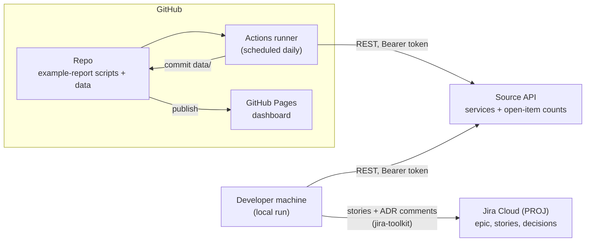
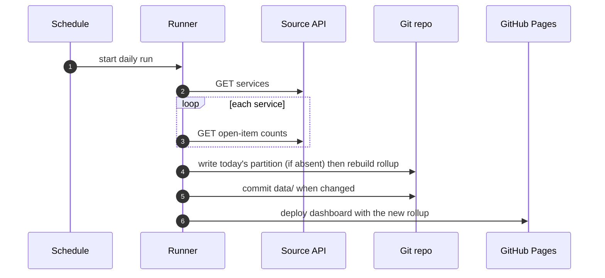
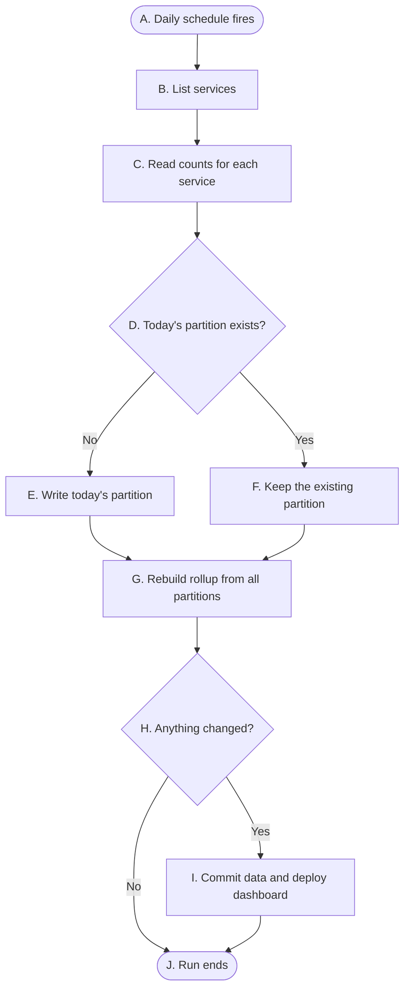
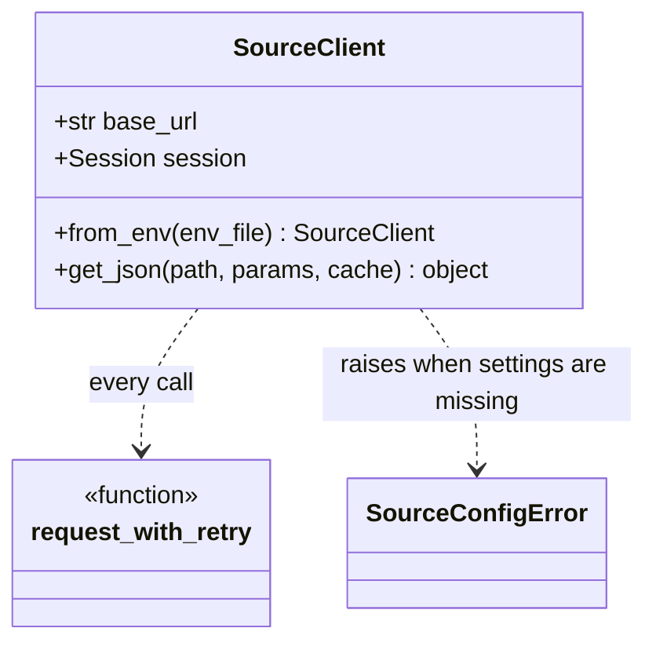

# Example Report — Technical Design Document (TDD)

> Status: **Example.** A filled-in sample showing the structure, diagrams, and walkthrough
> tables we expect in a TDD. It is the primary current-state technical reference for
> `example-report/`. Decisions are logged as ADRs in [decisions/](decisions/); this document
> reflects their outcome. See the PRD:
> [example-report-product-requirements.md](example-report-product-requirements.md). Start your
> own TDD from [templates/tdd-template.md](templates/tdd-template.md).

Last Updated: 2026-10-12

## 1. Scope of this design

The **first epic** (PRD goals **G1 + G2**): collect open-item counts daily from the Source
API, store them as immutable daily partitions, rebuild a rollup, and publish a static
dashboard. Alerting (G3) and export (G4) will extend this document in later epics.

## 2. System landscape

- The Source API is the only data source. Authentication is a Bearer token held in the repo
  `.env` locally and in a repository secret in Actions.
- Local runs may sit behind a TLS-inspecting proxy, so the REST helper uses the OS trust
  store and a browser-like User-Agent. Hosted runners need neither.

### 2.1 Daily run sequence

## 3. Data model

_Authoritative decision: [decisions/0003-immutable-daily-partitions-and-rollup.md](decisions/0003-immutable-daily-partitions-and-rollup.md)._

| File | Written by | Mutable? | Shape |
|---|---|---|---|
| `data/daily/<YYYY-MM-DD>.json` | collector, once per day | No (unless `--force`) | `{date, collectedAt, services: {key: {high, medium, low}}}` |
| `data/rollup.json` | collector, every run | Rebuilt | `{severities, days: [{date, totals, services}]}` |

**Naming:** the partition file name is the **reporting-zone** date of `collectedAt`:
`local_date(collectedAt).isoformat() + ".json"` ([ADR-0002](decisions/0002-store-utc-display-local-time.md)).

## 4. Configuration

All tunables live in `example-report/scripts/example_report_config.py`: Source API paths and
environment-variable names, severities, data paths, retry policy, and the reporting time zone.
Secrets come from `.env` (local) or repository secrets (Actions), never from code.

## 5. Components / modules

Code lives in `example-report/scripts/`. **Convention:** every module gets a class and/or flow
diagram here, kept in sync with the code as part of each story's Definition of Done. Deeper
how-to references live in `documentation/developer/`, linked from the relevant `§5.x`.

| Module | Role | Story |
|--------|------|-------|
| `example_report_config.py` | Shared constants and tunables. | PROJ-4 |
| `example_report_rest.py` | `SourceClient`: auth, retry/backoff, per-process cache, `utf-8-sig` decode. | PROJ-4 |
| `example_report_dates.py` | UTC storage, reporting-zone date derivation. | PROJ-4 |
| `example_report_collect.py` | CLI: collect counts, write partition, rebuild rollup. | PROJ-6 |
| `dashboard/` _(planned)_ | Static page that charts `rollup.json`. | PROJ-XXXX |

### 5.0 End-to-end flow

One daily run, from schedule to published dashboard.

| Step | At this node | Type | What happens | Then… | leading to |
|---|---|---|---|---|---|
| 1 | A. Daily schedule fires | Start | The scheduled workflow starts a run. | next | B. List services |
| 2 | B. List services | Process | The collector asks the Source API for every service. | next | C. Read counts for each service |
| 3 | C. Read counts for each service | Process | It reads each service's open-item counts and fills missing severities with zero. | next | D. Today's partition exists? |
| 4 | D. Today's partition exists? | Decision | It checks for a file named for today's reporting-zone date. | if **No** | E. Write today's partition |
| 5 | E. Write today's partition | Process | The day's counts are saved as a new, immutable file. | next | G. Rebuild rollup from all partitions |
| 6 | D. Today's partition exists? | Decision | A file for today is already there (for example, a re-run). | but if **Yes** | F. Keep the existing partition |
| 7 | F. Keep the existing partition | Process | History is left untouched. | next | G. Rebuild rollup from all partitions |
| 8 | G. Rebuild rollup from all partitions | Process | Totals per day are recomputed from every partition. | next | H. Anything changed? |
| 9 | H. Anything changed? | Decision | Git shows changes under `data/`. | if **Yes** | I. Commit data and deploy dashboard |
| 10 | I. Commit data and deploy dashboard | Process | The workflow commits the data and publishes the dashboard. | next | J. Run ends |
| 11 | H. Anything changed? | Decision | Nothing changed, so there is nothing to commit. | but if **No** | J. Run ends |
| 12 | J. Run ends | End | The run is complete. | — | — |

### 5.1 Configuration (`example_report_config.py`)

A module of constants, imported as `config`. It has no behavior to diagram; §4 lists what it
holds.

### 5.2 REST helper (`example_report_rest.py`)

`SourceClient` is the single doorway to the Source API. It applies the Bearer token, a
browser-like User-Agent, and the OS trust store; retries rate-limited and transient responses
with backoff; caches GET results per process; and decodes bodies as `utf-8-sig`.

`SourceClient` holds the connection identity (`base_url` and an authenticated `session`) and
exposes `get_json`, which checks the per-process cache before calling the module-level
`request_with_retry`. That function owns the HTTP send and the retry loop, so backoff is
applied in one place. `from_env` builds a client from `.env` and raises `SourceConfigError`
when the URL or token is missing.

**Detailed guide:** [developer/source-api-collector.md](developer/source-api-collector.md).

### 5.3 Dates (`example_report_dates.py`)

Three functions: `utc_now`, `to_utc_iso` (serialize as UTC), and `local_date` (the
reporting-zone calendar date for a datetime or UTC ISO string). Every date in the data and
dashboard goes through `local_date`; slicing a UTC string is a bug
([ADR-0002](decisions/0002-store-utc-display-local-time.md)).

### 5.4 Collector (`example_report_collect.py`)

The CLI that one run executes. Its flow is §5.0 nodes B–G; the functions map onto them:
`collect_counts` (B, C), `build_partition` + `write_partition` (D–F), and `build_rollup` (G).
`--force` overwrites today's partition; `--rollup-only` skips collection.

**Detailed guide:** [developer/source-api-collector.md](developer/source-api-collector.md).

### 5.5 Dashboard _(planned — PROJ-XXXX)_

A static page that loads `rollup.json` and charts totals by severity per day, with a
per-service filter. Charting library vendored into the repo (no CDN at runtime).

## 6. Orchestration (GitHub Actions) _(planned)_

- **Singleton workflow** `example-report-daily.yml`: `schedule` (daily, 06:00 UTC) plus
  `workflow_dispatch`.
- **Permissions:** top-level `contents: read`; the collect job elevates to `contents: write`
  to commit `data/`; the deploy job uses `pages: write` + `id-token: write`.
- **Secrets:** `SOURCE_API_TOKEN`, referenced by name (never dynamically).
- Set `PYTHONUNBUFFERED: "1"` so logs stream live.

## 7. Open technical questions

- Retention: keep every partition forever, or compact years older than N into one file?
