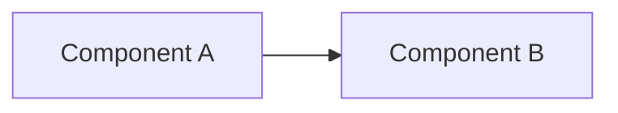
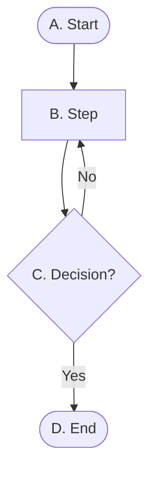

# <Product> — Technical Design Document (TDD)

> Status: **Draft / in progress.** The primary current-state technical reference. Decisions
> are logged as ADRs in [decisions/](../decisions/); this document reflects their outcome. See
> the PRD: _link_.

Last Updated: YYYY-MM-DD

## 1. Scope of this design
_Which PRD goals this covers now; what later epics will add._

## 2. System landscape
_A `flowchart LR` of the moving parts, then bullets on each integration (auth, network)._

### 2.1 Integration sequence
_A `sequenceDiagram` of the main run. No `;` in message text._

## 3. Data model
_Files, schemas, naming formulas (state the exact formula), mutability._

## 4. Configuration
_Where tunables live (`<project>_config.py`) and where secrets come from._

## 5. Components / modules

**Convention:** every module gets a class and/or flow diagram here, kept in sync with the code
as part of each story's Definition of Done. Deeper how-tos live in `documentation/developer/`
and are linked with a **Detailed guide** pointer at the end of the relevant §5.x.

| Module | Role | Story |
|--------|------|-------|
| `module.py` | | PROJ-XXXX |

### 5.0 End-to-end flow
_Brief description, then the flowchart, then the walkthrough table._

| Step | At this node | Type | What happens | Then… | leading to |
|---|---|---|---|---|---|
| 1 | A. Start | Start | | next | B. Step |
| 2 | B. Step | Process | | next | C. Decision? |
| 3 | C. Decision? | Decision | | if **No** | B. Step |
| 4 | C. Decision? | Decision | | but if **Yes** | D. End |
| 5 | D. End | End | | — | — |

### 5.1 <Module> (`module.py`)
_Prose, then a class diagram (structural → prose only, no table) or a flowchart + table
(process)._

**Detailed guide:** _link to `documentation/developer/<guide>.md`._

## 6. Orchestration (GitHub Actions)
_Workflows, triggers, least-privilege permissions per job, named secrets._

## 7. Open technical questions
- _Short-lived; codify answers above or in an ADR._
