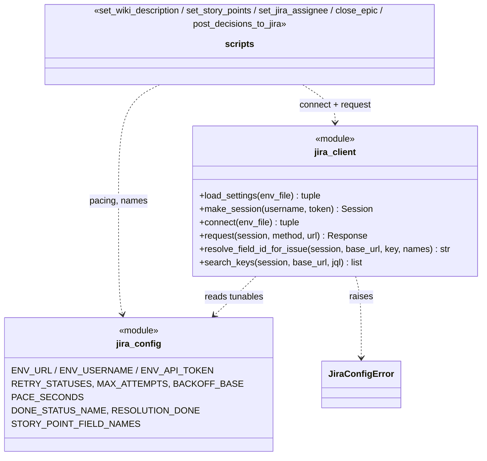
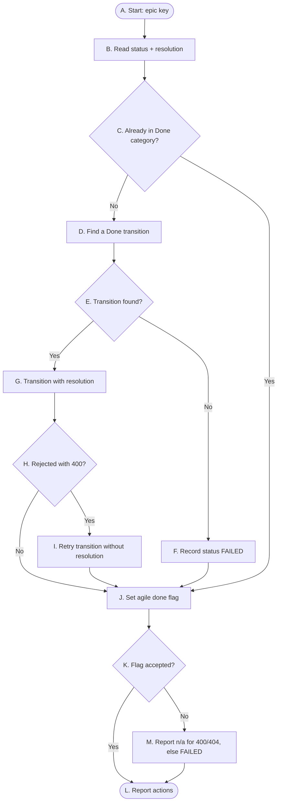

# Jira Toolkit — Technical Design (TDD)

> Portable Jira automation toolkit for this repo, designed to be lifted into other repos or
> centralized into a shared package. This document describes the current structure and how
> the pieces fit together. Companion to [jira-sync.md](jira-sync.md) (usage/conventions) and
> [jira-mcp-architecture-explainer.md](jira-mcp-architecture-explainer.md).

Last Updated: 2026-10-12

## 1. Purpose & scope

Provide a small, portable set of tools to manage Jira from the repo:
- **Push user stories** to Jira from markdown (markdown is the source of truth).
- **Bulk and markup-sensitive issue operations** (descriptions, story points, assignees, epic
  closure, decision comments) that are reliable under Jira Cloud rate limits.
- A documented **MCP integration** so an AI agent can read/write Jira interactively.

Targets a **default Jira Cloud** site (built-in issue types, statuses, and system fields) using an
**Atlassian account email + API token**. Out of scope (future epic): a fully automated,
bidirectional Python + GitHub Actions sync.

## 2. Directory structure

Everything portable lives under `jira-toolkit/`; two VS Code integration files must live at
their fixed paths (see §5).

```
jira-toolkit/
├─ README.md                            # inventory + porting steps
├─ mcp.jira.json                        # portable reference of the MCP server config
├─ scripts/
│  ├─ jira_config.py                    # tunables: env names, retry, workflow names, field names
│  ├─ jira_client.py                    # shared REST helper: auth, retry, field lookup, search
│  ├─ set_wiki_description.py           # PUT a raw wiki-markup description
│  ├─ set_story_points.py               # set points, field found by name per issue
│  ├─ set_jira_assignee.py              # bulk set/clear assignee by accountId
│  ├─ close_epic.py                     # status → Done (+resolution), agile done flag
│  ├─ post_decisions_to_jira.py         # sync ADR decisions as Jira comments
│  └─ requirements.txt                  # requests, python-dotenv, truststore
├─ tests/                               # pytest, one test_<module>.py per script, network mocked
├─ documentation/
│  ├─ jira-sync.md                      # sync model, conventions, utilities, tunables
│  ├─ jira-mcp-architecture-explainer.md
│  └─ jira-toolkit-technical-design.md  # this file
└─ prompts/
   └─ sync-stories-to-jira.prompt.md    # agent prompt to push stories to Jira

# Required at VS Code paths (outside jira-toolkit/ — see §5):
.vscode/mcp.json                        # active MCP server config
.vscode/settings.json                   # chat.promptFilesLocations -> jira-toolkit/prompts
```

## 3. Architecture & data flow

Two complementary access paths, chosen by task:

- **MCP (agent-driven, interactive):** the `jira` server (`uvx mcp-atlassian`) exposes tools
  (`jira_search`, `jira_create_issue`, `jira_update_issue`, `jira_transition_issue`,
  `jira_link_to_epic`, …) the agent calls directly. Best for reads and small, interactive
  changes.
- **Paced REST scripts (bulk / exact markup):** direct `requests` calls through
  `jira_client.request`, with retry/backoff and pauses between issues. Best for multi-issue
  operations and for descriptions that the MCP markdown converter would mangle.

Source-of-truth flow for stories: `*-user-stories.md` → (prompt/agent) → Jira issues, with the
real `PROJ-####` key written **back** into the markdown heading. Jira is a mirror.

**Decision sync:** ADRs under `documentation/decisions/` are posted as comments on the Jira
issue named in each ADR's `- Jira:` line via `post_decisions_to_jira.py` (idempotent:
unchanged skipped, changed updated, matched by a hidden marker + hash).

### 3.1 Shared client (`jira_client.py`)

Every script goes through one module so auth, retry, and field discovery behave the same
everywhere.



`jira_config` holds every tunable. `jira_client.connect` loads the three settings from `.env`
(raising `JiraConfigError` when any is missing), applies the OS trust store, and returns an
authenticated session plus base URL. `request` is the single HTTP doorway: it retries
429/5xx responses, waiting for `Retry-After` when Jira sends it. `resolve_field_id_for_issue`
reads an issue's edit metadata (cached per process) to find a field by name, which is how
story points work without a hard-coded id. `search_keys` pages through
`/rest/api/3/search/jql` with `nextPageToken`. Each script is a thin CLI over these.

### 3.2 Closing an epic (`close_epic.py`)



| Step | At this node | Type | What happens | Then… | leading to |
|---|---|---|---|---|---|
| 1 | A. Start: epic key | Start | The script is given an epic key (or one key from a JQL result). | next | B. Read status + resolution |
| 2 | B. Read status + resolution | Process | It reads the epic's current status category and resolution. | next | C. Already in Done category? |
| 3 | C. Already in Done category? | Decision | It checks whether the epic is already done. | if **No** | D. Find a Done transition |
| 4 | D. Find a Done transition | Process | It lists the available transitions and picks one that lands in the Done category, preferring a status named `Done`. | next | E. Transition found? |
| 5 | E. Transition found? | Decision | No such transition exists for this epic. | if **No** | F. Record status FAILED |
| 6 | F. Record status FAILED | Process | The failure is noted; the script still tries the agile flag. | next | J. Set agile done flag |
| 7 | E. Transition found? | Decision | A Done transition is available. | but if **Yes** | G. Transition with resolution |
| 8 | G. Transition with resolution | Process | It moves the epic to Done and sends Resolution = Done. | next | H. Rejected with 400? |
| 9 | H. Rejected with 400? | Decision | The transition screen doesn't accept a resolution. | if **Yes** | I. Retry transition without resolution |
| 10 | I. Retry transition without resolution | Process | It repeats the transition without the resolution field; the workflow sets it. | next | J. Set agile done flag |
| 11 | H. Rejected with 400? | Decision | The transition succeeded. | but if **No** | J. Set agile done flag |
| 12 | C. Already in Done category? | Decision | The epic was already done. | but if **Yes** | J. Set agile done flag |
| 13 | J. Set agile done flag | Process | It posts `{"done": true}` to the agile epic endpoint. | next | K. Flag accepted? |
| 14 | K. Flag accepted? | Decision | The project type doesn't use the flag, or the call failed. | if **No** | M. Report n/a for 400/404, else FAILED |
| 15 | M. Report n/a for 400/404, else FAILED | Process | 400/404 counts as not applicable; anything else is a failure. | next | L. Report actions |
| 16 | K. Flag accepted? | Decision | The flag was set. | but if **Yes** | L. Report actions |
| 17 | L. Report actions | End | The list of actions for this epic is printed. | — | — |

## 4. Authentication, network & TLS

- **Settings** in the repo-root `.env` (gitignored): `JIRA_URL`, `JIRA_USERNAME` (account
  email), `JIRA_API_TOKEN`.
- **MCP** reads the same file via the `envFile` setting in `.vscode/mcp.json`; `mcp-atlassian`
  uses exactly these variable names for Jira Cloud.
- **REST scripts** use HTTP Basic (email + token), load `.env` via `python-dotenv`, use the
  **OS trust store** (`truststore`) when installed, and send a browser-like `User-Agent`
  (some gateways drop the default `python-requests` agent).
- **Writes use REST API v2** so descriptions and comments can stay in wiki markup.
  Search uses `/rest/api/3/search/jql`, the paginated replacement for the retired
  `/search` endpoint.

## 5. VS Code integration points (must stay outside `jira-toolkit/`)

VS Code / Copilot only load these from fixed locations:
- **`.vscode/mcp.json`** — the active MCP server definition. The portable copy is
  `jira-toolkit/mcp.jira.json`; merge its `jira` server block when porting. Claude Code reads
  the repo-root **`.mcp.json`** instead, which passes `--env-file .env` because Claude Code has
  no `envFile` setting.
- **`.vscode/settings.json`** (single-folder) or the **workspace file** (multi-root) — sets
  `chat.promptFilesLocations` to include `jira-toolkit/prompts`. In a multi-root workspace,
  VS Code ignores this window-level setting in a folder's own settings file.

## 6. Conventions

See [jira-sync.md](jira-sync.md) for detail. In short:
- Built-in issue types only: `Epic`, `Story`, `Task` (spikes, summary prefixed `Spike:`),
  `Bug`, `Subtask`.
- Default statuses only: `To Do`, `In Progress`, `Done`; richer stages are signaled with
  status-change comments and the built-in flag.
- Epics are the issue's **parent**; story points are found by field name, never by id.
- Acceptance criteria live in the description.
- Never close an issue without explicit user confirmation.

## 7. Portability

To reuse in another repo: copy `jira-toolkit/`, merge `jira-toolkit/mcp.jira.json` into
`.vscode/mcp.json`, add `jira-toolkit/prompts` to `chat.promptFilesLocations`, set the three
`JIRA_*` values in `.env`, and `pip install -r jira-toolkit/scripts/requirements.txt`. Full
steps in [../README.md](../README.md).

## 8. Future work

- Automated, testable **Python + GitHub Actions** sync (parse markdown → idempotent
  create/update, key write-back) — its own epic via the PRD → TDD → stories flow.
- Additional paced helpers (bulk transitions with status-change comments) following the
  `jira_client` pattern.
